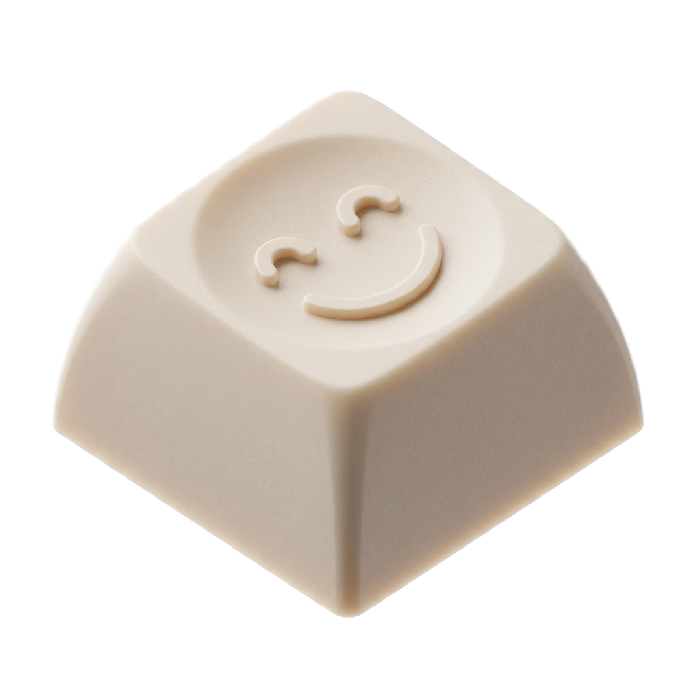

<div align="center">



# ✦ T A P T A P ✦

### *Ultra-Lightweight Rust + Tauri Spatial Surround Sound Companion for Mechanical Keyboards & Mice*

[](https://mightyiest.github.io/taptap/)
[](https://github.com/Mightyiest/taptap/releases)
[](src-tauri/Cargo.toml)
[](#-v200-rust-rewrite--efficiency-leap)
[](src-tauri/src/audio.rs)
[](scripts/vault-cli.js)
[](LICENSE)

<br />

<p align="center">
  <b>Taptap v2.0.0</b> elevates every keystroke and mouse click into an artisanal 3D spatial acoustic experience—now powered by a <b>native Rust + Tauri v2 audio core</b> that cuts idle background memory from <b>70–100 MB (Electron)</b> down to <b>~5 MB</b> with zero background browser processes.
</p>

<p align="center">
  <a href="https://mightyiest.github.io/taptap/"><b>▶ Launch Live Web Demo & Testing Soundstage</b></a>
</p>

---

</div>

## ⚡ v2.0.0 Rust Rewrite & Efficiency Leap

The v2.0.0 milestone replaces the resident Electron + Chromium desktop runtime with a native **Rust + Tauri v2** backend (`src-tauri/`), dramatically reducing RAM usage, disk footprint, and audio latency while keeping the browser Web Audio API engine intact for the GitHub Pages web demo.

| Metric / Area | v1.x (Electron + Chromium) | v2.0.0 (Rust + Tauri v2) | Improvement |
| :--- | :---: | :---: | :--- |
| **Background / Stealth Tray RAM** | ~70 MB – 100 MB+ (Chromium + Node) | **~4.3 – 5 MB private RAM** (`0` WebView2 processes) | **~93–95% less RAM** |
| **Audio Backend** | Web Audio API in Chromium renderer | **Native Rust WASAPI (`cpal` + `symphonia`)** | Zero browser overhead |
| **Windows Setup Installer** | Electron NSIS (~70+ MB) | **`4.83 MiB`** (`Taptap_2.0.0_x64-setup.exe`) | **>93% smaller** |
| **Single-File Portable EXE** | Electron Portable (~70+ MB) | **`12.30 MiB`** (`Taptap_2.0.0_x64-portable.exe`, all 23 `.tap` vaults embedded) | Zero-install standalone |
| **Global Input Interception** | Node `uiohook-napi` + IPC | **Native Win32 `WH_KEYBOARD_LL` / `WH_MOUSE_LL`** | Sub-millisecond trigger path |
| **Tray Stealth Architecture** | Hidden BrowserWindow stays resident | **Destroys WebView2 completely on close/minimize** | Reopens on tray click in <1s |

### What Else Changed in v2.0.0
- **Fixed Focused Mouse Double-Sounds**: Resolved `WindowFromPoint` returning child `msedgewebview2.exe` HWNDs in Rust (`GetAncestor` `GA_ROOT` / `GA_ROOTOWNER` check), added focused-window guards in Electron `uIOhook`, and unified DOM click exclusion zones.
- **Fixed Focused Keyboard Sound & Typing Test**: Added 45 ms per-key deduplication in Rust (`AudioController::trigger_checked`, cleared on release), wired `#hiddenGameInput` focus management, prevented sliders/toggles/dropdowns from trapping keyboard focus, and streamlined countdown timers.
- **Removed 60/120fps GPU Toggle & Restart Modal**: Hardware-accelerated composition runs natively without manual FPS/GPU flags or restart prompts.
- **UI & High-DPI Refinements**: Enforced a clean fixed `540×650` companion window (`resizable = false`), added a Settings toggle to enable/disable the right-click Inspect context menu (disabled by default), resized slider thumbs so labels are never obscured, and made all tabs—including Settings & *About Taptap*—responsive and fluid.

---

## ✧ Highlights & Core Capabilities

- **🌐 3D Binaural Soundstage**: Realistic spatial audio positioning using custom Rust HRTF ITD/ILD + head-shadow DSP (`src-tauri/src/audio.rs`) on desktop and Web Audio API `PannerNode` in browsers. Every keystroke is dynamically placed across X/Y/Z coordinates matching your physical keyboard layout (`ANSI 60%`, `65%`, `75%`, `Apple Mac 65%`).
- **🛡️ Cryptographic Acoustic Vault (`.tap`)**: Proprietary `TAPTAP_VAULT_V1` binary container format with symmetric in-memory stream descrambling and tokenized sample identifiers (`assets/vault/`). Zero raw `.wav` or `.mp3` files are shipped or exposed.
- **🔒 Single-Instance Lock & Instant Wakeup**: Windows named mutex (`Global\TaptapRustCompanionSingleInstance`) + message-only wakeup window prevents duplicate processes and brings the active instance to focus cleanly.
- **⌨️ 22 Curated Luxury Switch Acoustics & 8 Mouse Models**: Handcrafted acoustic profiles spanning Linear (*Lofree Pulse/Surfer, Akko Piano Pro, Akko Cream Yellow, Akko CS Jelly Black, Durock Alpaca V2, Gateron Ink Black/Red, Tealios, NovelKeys Cream, Keychron Red*), Tactile (*Drop Holy Panda, Keychron Brown, Topre Realforce 45g, Alps SKCM Blue*), Clicky (*Kailh Box Navy, Akko Pink, IBM Model M*), Muted/Novelty (*Lofree Void, IQUNIX MQ80, Lizard Pop, Ticks Mechanical*), plus 8 tactile mouse click profiles.
- **🎨 Beige & Maroon Luxury Aesthetic**: Warm alabaster linen (`#fbf8f2`) and royal bordeaux (`#721825`) light/dark themes, `Plus Jakarta Sans`, `Quicksand`, and `Cinzel` typography, and a frameless custom window shell.
- **🎯 Interactive Typing Test & Soundstage Radar**: Real-time on-demand HTML5 canvas radar visualizer paired with a built-in typing speed mini-game (`3.. 2.. 1.. GO!` countdown, live WPM, accuracy, and instant restart/stop).
- **🪟 True Stealth Mode**: Closing or minimizing destroys the UI layer while keeping Rust WASAPI audio, global hooks, and the <kbd>Ctrl</kbd> + <kbd>Shift</kbd> + <kbd>M</kbd> mute hotkey active at ~5 MB RAM.

---

## 🌐 Live Web Demo vs. Rust Desktop Companion

Taptap runs both as a **lightweight native Windows companion** and an **instant web testing soundstage**:

| Capability | Live Web Demo (GitHub Pages) | Rust + Tauri Desktop App |
| :--- | :---: | :---: |
| **Instant In-Browser Sound Testing** | ✅ Yes (Zero installation) | ✅ Yes |
| **Interactive Typing Mini-Game** | ✅ Yes | ✅ Yes |
| **Full 22 Switch & 8 Mouse Vault** | ✅ Yes (In-memory decrypt) | ✅ Yes (In-memory decrypt) |
| **3D HRTF Soundstage & Radar Visualizer** | ✅ Yes | ✅ Yes |
| **Light / Dark Luxury Themes** | ✅ Yes | ✅ Yes |
| **System-Wide Background Hooks** | ❌ (Browser sandbox limited) | ✅ Yes (Win32 LL hooks) |
| **System Tray Stealth Mode (~5 MB RAM)** | ❌ | ✅ Yes |
| **Global Mute Hotkey (`Ctrl+Shift+M`)** | ❌ | ✅ Yes |
| **Single-Instance Enforcement** | ❌ | ✅ Yes |

👉 **Try the Live Web Demo now**: [mightyiest.github.io/taptap](https://mightyiest.github.io/taptap/)

---

## 🎧 Rust Architecture & Signal Pipeline

```
┌────────────────────────────────────────────────────────────────┐
│               Global System-Wide Input (Win32)                 │
│     • WH_KEYBOARD_LL + WH_MOUSE_LL + Ctrl+Shift+M Hotkey       │
│     • Focused-window detection via GetAncestor(GA_ROOTOWNER)   │
└───────────────────────────────┬────────────────────────────────┘
                                │ (Lock-free channel + 45ms key dedupe)
                                ▼
┌────────────────────────────────────────────────────────────────┐
│              Rust Native Audio Core (src-tauri/)               │
│                                                                │
│  ┌──────────────────────────────────────────────────────────┐  │
│  │           Acoustic Vault Descrambler (vault.rs)          │  │
│  │   • In-Memory TAPTAP_VAULT_V1 XOR Stream Cipher          │  │
│  │   • Symphonia WAV/MP3 PCM Decoding + LRU Pack Cache      │  │
│  └────────────────────────────┬─────────────────────────────┘  │
│                               ▼                                │
│  ┌──────────────────────────────────────────────────────────┐  │
│  │         3D Spatial Mixer & Output (audio.rs)             │  │
│  │   • Per-key HRTF ITD/ILD + Head-Shadow & Elevation Shelf │  │
│  │   • Dynamic Cursor X Panning & Micro-Pitch Jitter        │  │
│  │   • Lock-free 64-voice cpal WASAPI Output Stream         │  │
│  └──────────────────────────────────────────────────────────┘  │
└───────────────┬───────────────────────────────┬────────────────┘
                │                               │ (Optional UI events)
                ▼                               ▼
     [ WASAPI Audio Output ]       [ Tauri WebView2 Companion UI ]
                                   (Destroyed in Tray Stealth Mode)
```

---

## 🚀 Getting Started

### Option 1: Install Prebuilt Windows Setup or Run Portable EXE (Recommended)
Run either artifact staged in `dist/`:
- **Windows Setup Installer**: `dist/Taptap_2.0.0_x64-setup.exe` (also at `src-tauri/target/release/bundle/nsis/Taptap_2.0.0_x64-setup.exe`)
- **Single-File Portable EXE**: `dist/Taptap_2.0.0_x64-portable.exe` (zero installation required — runs standalone from any folder)
- Or download from [GitHub Releases](https://github.com/Mightyiest/taptap/releases).

### Option 2: Build & Run from Source

#### Prerequisites
- [Node.js](https://nodejs.org/) (v18.0 or higher) & `npm`
- [Rust toolchain (`rustup` / `cargo`)](https://rustup.rs/)
- On Windows GNU target (`x86_64-pc-windows-gnu`): WinLibs MinGW-w64 (`gcc`/`windres`) — `scripts/run-cargo.js` automatically discovers `%USERPROFILE%\.cargo\bin` and WinGet-installed WinLibs MinGW paths even in existing terminals.

#### Commands

1. **Clone and install Node dev dependencies:**
   ```bash
   git clone https://github.com/Mightyiest/taptap.git
   cd taptap
   npm install
   ```

2. **Launch Rust + Tauri Desktop App (Dev):**
   ```bash
   npm run rust:dev
   ```

3. **Run Rust Unit Tests:**
   ```bash
   npm run rust:test
   ```

4. **Launch Web Preview Locally:**
   ```bash
   npm run preview
   ```

5. *(Legacy Electron fallback, ~70–100 MB RAM)*:
   ```bash
   npm start
   ```

---

## 📦 Building Standalone Rust Binaries, Portable EXE & Windows Installer

Build the optimized release binary, NSIS Windows installer, and single-file Portable executable using the bundled Cargo/Tauri CLI scripts:

```bash
# Build BOTH Windows NSIS Installer + Single-File Portable EXE into dist/
npm run rust:package

# Or build individually:
npm run rust:installer   # -> dist/Taptap_2.0.0_x64-setup.exe & src-tauri/target/release/bundle/nsis/
npm run rust:portable    # -> dist/Taptap_2.0.0_x64-portable.exe (standalone single-file EXE)
npm run rust:build       # -> src-tauri/target/release/taptap.exe
```

*(Legacy Electron packaging remains available via `npm run dist`, `npm run dist:nsis`, and `npm run dist:portable`.)*

---

## 🌐 Deploying & Enabling GitHub Pages

This repository includes automated GitHub Pages deployment via GitHub Actions (`.github/workflows/deploy-pages.yml`) and `.nojekyll` protection.

To activate GitHub Pages for your repo:
1. Go to your repository on GitHub: `https://github.com/Mightyiest/taptap`
2. Click **Settings** ➔ **Pages** (in the left sidebar).
3. Under **Build and deployment** ➔ **Source**:
   - Choose **GitHub Actions** (recommended — deploys automatically on push).
   - *Or* select **Deploy from a branch** ➔ select branch `main` with folder `/ (root)` and click **Save**.
4. Your live interactive testing companion will be live at:
   **`https://mightyiest.github.io/taptap/`**

---

## 🔒 Acoustic Vault CLI Utilities

Taptap includes a built-in cryptographic asset manager:

```bash
# Verify integrity of all encrypted sound containers and security perimeter
npm run vault:verify

# Pack raw sound directories into .tap binary containers
npm run vault:pack
```

> [!NOTE]
> **Audio Protection Perimeter**: All audio samples are tokenized and protected inside proprietary `.tap` containers. Raw audio files (`.wav`, `.mp3`) are strictly blocked from version control by policy and `.gitignore` rules.

---

## ⌨️ Shortcuts & Controls

| Shortcut / Control | Function |
| :--- | :--- |
| <kbd>Ctrl</kbd> + <kbd>Shift</kbd> + <kbd>M</kbd> | Global Toggle Mute / Unmute (Desktop) |
| <kbd>Window Close [✕]</kbd> / <kbd>Minimize</kbd> | Enters ~5 MB Stealth Tray Mode (Desktop) |
| <kbd>Tray Left-Click</kbd> | Toggles Taptap companion window open/closed |
| <kbd>Spatial Spread Slider</kbd> | Adjusts binaural stereo separation width (0% – 180%) |
| <kbd>Elevation Toggle</kbd> | Enables 3D vertical soundstage acoustics (Z-axis) |
| <kbd>Esc</kbd> *(Typing Test)* | Closes active modal or stops running typing test |

---

## 📁 Repository Structure

```
Taptap/
├── .github/
│   └── workflows/
│       └── deploy-pages.yml      # Automated GitHub Pages deployment
├── .agents/                      # AI Agent guidelines and audio protection rules
├── src-tauri/                    # Native Rust + Tauri v2 backend
│   ├── src/
│   │   ├── main.rs               # Single-instance mutex, tray stealth, Tauri commands
│   │   ├── audio.rs              # 64-voice cpal WASAPI mixer, HRTF/Stereo DSP, dedupe
│   │   ├── hooks.rs              # Win32 WH_KEYBOARD_LL / WH_MOUSE_LL + GA_ROOT check
│   │   ├── settings.rs           # Persistent settings & Windows Registry autostart
│   │   ├── spatial.rs            # Key-to-coordinate spatial & category mapping
│   │   └── vault.rs              # In-memory .tap descrambler & symphonia PCM decoder
│   ├── capabilities/default.json # Tauri v2 window/event/tray permissions
│   ├── Cargo.toml                # Rust manifest & size-optimized release profile
│   ├── build.rs                  # Windows resource icon + WebView2Loader setup
│   └── tauri.conf.json           # App bundle, NSIS installer, and vault resource config
├── assets/
│   ├── brands/                   # Manufacturer badges for the 22 switch profiles
│   ├── vault/                    # Encrypted .tap binary soundpack containers
│   ├── icon.ico                  # Windows application icon
│   └── icon.png                  # Application logo
├── scripts/
│   ├── prepare-ui.js             # Stages minimal ui-dist/ bundle for Tauri
│   ├── run-cargo.js              # Cargo & Tauri CLI launcher with toolchain discovery
│   └── vault-cli.js              # Vault verification and encryption CLI
├── app.html                      # Desktop companion application UI
├── app.js                        # UI controllers, radar canvas, typing test engine
├── audio-engine.js               # Hybrid Web Audio API / Tauri audio bridge
├── styles.css                    # Beige & Maroon luxury design system & themes
├── main.js                       # Legacy Electron main process (fallback)
├── index.html / landing.js / landing.css # GitHub Pages showcase & live web demo
├── package.json                  # Project metadata, Rust & Electron scripts
├── LICENSE                       # MIT License
└── README.md                     # Project documentation
```

---

## 📄 License

This project is licensed under the [MIT License](LICENSE).

---

<div align="center">
  <sub>Crafted with meticulous attention to acoustic fidelity and bespoke design.</sub>
</div>
